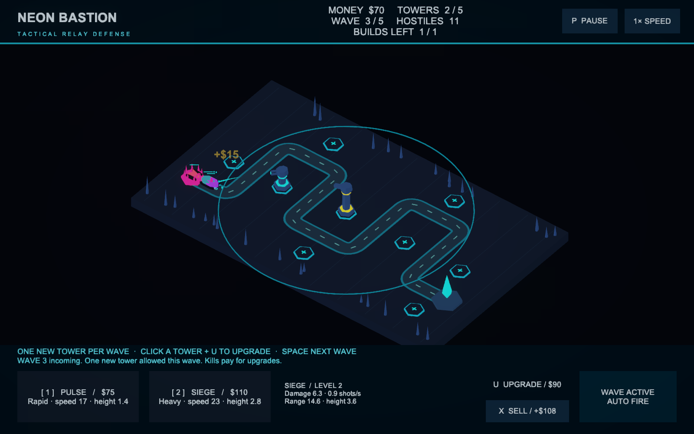

# Neon Bastion — 3D Physics Tower Defense

A complete tower-defense game built from the Tower-Projectiles starter assignment. Protect the cyan relay at the end of a winding route. **One escaped enemy ends the game.** Defeat all five waves to win.

## Open in Unity

1. In Unity Hub, choose **Add → Add project from disk** and select this folder.
2. Open it with **Unity 6000.6.0f1**, the editor already installed on this Mac.
3. Double-click **Assets/Scenes/NeonBastion.unity** in the Project panel.
4. Press **Play**, then click **ENTER SECTOR** or press Enter.

The downloaded starter used Unity 6000.3.23f1. This separate copy was opened with 6000.6.0f1. The original starter is preserved in Downloads. `SampleScene.unity` and its scripts are retained for reference; use `NeonBastion.unity` for the assignment.

The board, camera and interface appear when Play starts. Custom drone hulls, turret platforms, crystals and curved-road meshes are saved in `Assets/Defense/Resources/DefenseMeshes`.

## Controls

| Action | Control |
| --- | --- |
| Choose Pulse / Siege tower | Buttons or **1 / 2** |
| Place a tower | Left-click a free cyan hexagonal pad |
| Inspect tower and show range | Left-click its occupied pad |
| Launch next wave | Button or **Space** |
| Upgrade selected tower | Button or **U** |
| Sell selected tower | Button or **X** |
| Pause / resume | Button or **P** |
| Toggle 1× / 2× speed | Speed button |
| Start / replay | Button or **Enter** |

Towers choose targets, predict movement, and fire automatically. You can build and upgrade during a wave. Build only on marked pads, with **ONE new tower per wave and five towers maximum**. Setup and combat share that allowance; selling does not restore it, and unused allowances do not accumulate. You start with **$110**. Money comes from monster kills, with no wave-clear bonus.

Begin with one Pulse tower on the left interior pad. The first kill gives you enough money for its level-2 upgrade. Save for a Siege tower near the center in wave 2. Each later wave unlocks one more placement, which can be used during setup or combat. Cover several road sections with each tower and balance purchases against upgrades.

## Towers

| Stat at level 1 | Pulse | Siege |
| --- | --- | --- |
| Placement cost | 75 | 110 |
| Shots per second | 2.4 | 0.75 |
| Projectile speed | 17 units/s | 23 units/s |
| Turret height | 1.4 units | 2.8 units |
| Damage per hit | 1.15 | 4.5 |
| Range | 10.5 units | 14 units |

Towers can reach level 3. Each level increases damage, fire rate, range, and actual turret height by **0.8 units**. The column extends and the firing muzzle rises; glowing collars mark upgrades. Upgrades cost $45 and $90. Selling returns 70% of the tower's total investment but never restores a used wave allowance. You cannot sell your last tower when no replacement placement remains.

## Enemies

| Type | Speed | Base HP | Kill reward | Role |
| --- | --- | --- | --- | --- |
| Scout | 2.6 units/s | 4 | $10 | Standard drone |
| Runner | 3.9 units/s | 3 | $15 | Fast, lightly armored |
| Armored | 1.65 units/s | 12 | $25 | Slow, durable crawler |
| Siege | 1.25 units/s | 48 | $100 | Final-wave heavy |

Every destroyed monster pays immediately, with a gold `+$` popup and an updated money balance.

HP increases by 12% of base per wave after wave 1. Five waves contain 8, 11, 13, 16 and 20 enemies, for 68 enemies total.

## Assignment coverage

See [ASSIGNMENT_NOTES.md](ASSIGNMENT_NOTES.md) for the requirement-to-code map and the predictive aiming explanation. All C, B and A features are implemented. Upgrades, selling, a five-wave campaign, range indicators, health bars, impact effects, pause, speed control, menus and replay are additional polish; the instructor determines whether these earn A+ credit.

## Checks and preview

Use **Tools → Neon Bastion → Validate assignment and campaign** while outside Play mode to run the actual-scene checks. The validator opens the game scene, exercises its physics and controls through their shared game methods, plays an automated campaign, and exits Play mode. It does not save test placements into the scene. See `VALIDATION.md` for results and limits.

The scene and custom mesh assets can be rebuilt with **Tools → Neon Bastion → Rebuild authored assets and scene**. This intentionally replaces the generated game scene; it is not required for normal play.

## GitHub submission

Upload the entire project folder using GitHub Desktop, including `Assets` with all `.meta` files, `Packages`, and `ProjectSettings`. The `.gitignore` excludes Unity's generated Library, Temp, Logs and local settings. Git LFS is not required. Add this folder as a new local repository, make an initial commit, then publish it to your GitHub account. Submit the repository link; if private, invite the instructor as a collaborator.

## Asset attribution

The new game models, environment meshes and shader are created in code for this project; no outside art packs were downloaded. Unity's built-in shapes supplement the custom meshes. Starter files and package dependencies remain from the provided Tower-Projectiles project. Read the code and adapt the explanations to your course's attribution requirements before presenting it.

## Sharp Game view on Retina displays

If the whole image or text looks pixelated, stop Play mode, let Unity finish recompiling, then choose **Tools → Neon Bastion → Sharpen Game View** and press Play again. This disables the editor's low-resolution preview and resets its zoom. The project uses native render scale, 4x MSAA and high-quality SMAA; canvas elements snap to pixels, and fine world lines are thickened to avoid disappearing between pixels. Player builds use the render settings without relying on the editor helper.
