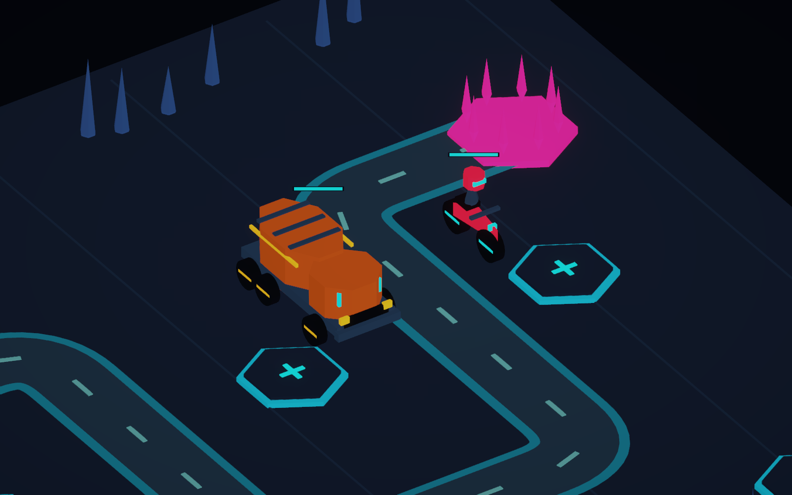
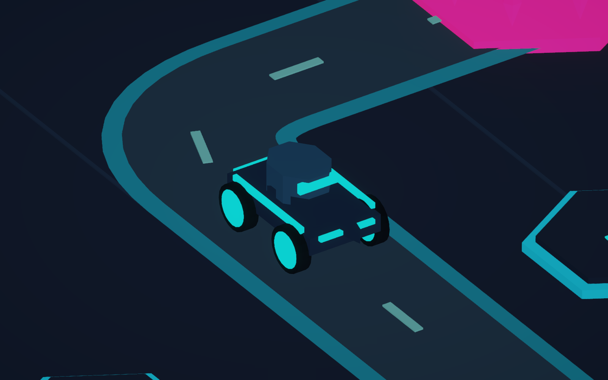
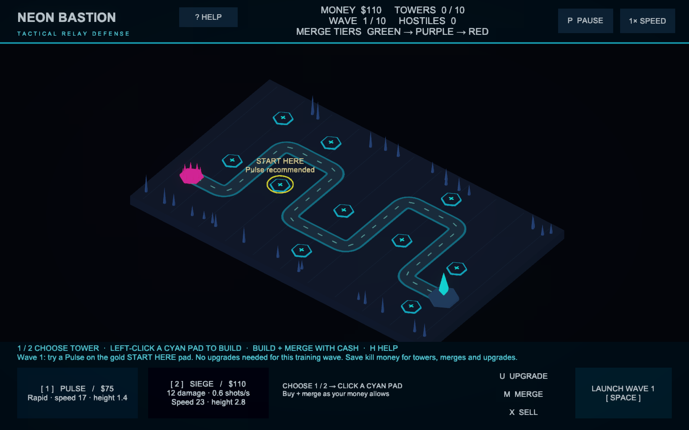
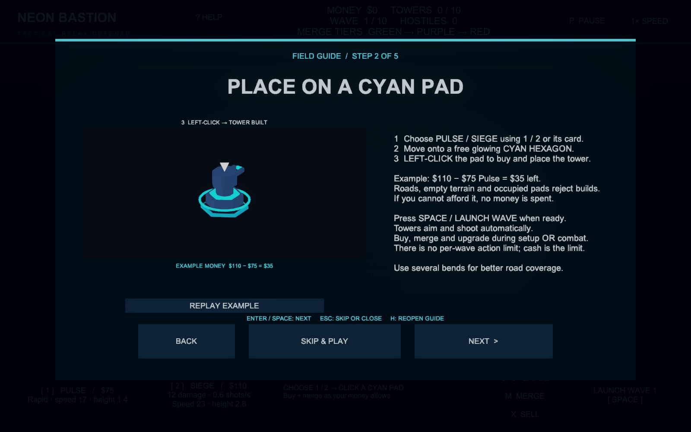
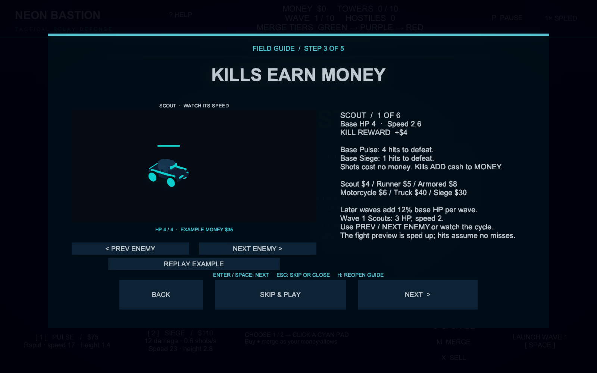
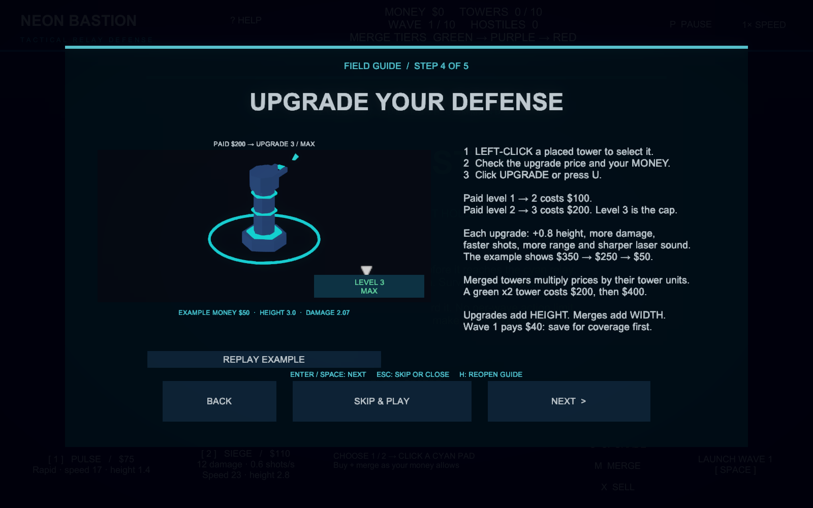

# Neon Bastion — 3D Physics Tower Defense

A complete tower-defense game built from the Tower-Projectiles starter assignment. Protect the cyan relay at the end of a winding route. **One escaped enemy ends the game.** Defeat all ten waves to win.

## Open in Unity

1. In Unity Hub, choose **Add → Add project from disk** and select this folder.
2. Open it with **Unity 6000.6.0f1**, the editor already installed on this Mac.
3. Double-click **Assets/Scenes/NeonBastion.unity** in the Project panel.
4. Press **Play**, then click **ENTER SECTOR** or press Enter. Follow the five-step quick tutorial, or choose **SKIP & PLAY**.

The downloaded starter used Unity 6000.3.23f1. This separate copy was opened with 6000.6.0f1. The original starter is preserved in Downloads. `SampleScene.unity` and its scripts are retained for reference; use `NeonBastion.unity` for the assignment.

The board, camera and interface appear when Play starts. Custom drone hulls, turret platforms, crystals and curved-road meshes are saved in `Assets/Defense/Resources/DefenseMeshes`.

## Controls

| Action | Control |
| --- | --- |
| Choose Pulse / Siege tower | Buttons or **1 / 2** |
| Place a tower | Left-click a free cyan hexagonal pad |
| Inspect tower and show range | Left-click its occupied pad |
| Launch next wave | Button or **Space** |
| Upgrade selected tower | Button or **U** |
| Merge matching placed towers | Hold left mouse on one, drag onto a same-type tower, release |
| Click-based merge | Select a tower → **M / MERGE** → click a matching tower; **Escape** cancels |
| Sell selected tower | Button or **X** |
| Reopen quick tutorial | **? HELP** button or **H** |
| Tutorial navigation | **Next / Back**, Enter / Space, or Left Arrow; Escape skips/closes |
| Pause / resume | Button or **P** |
| Toggle 1× / 2× speed | Speed button |
| Start / replay | Button or **Enter** |

Towers choose targets, predict movement, and fire automatically. Buy, merge and upgrade during setup or combat as often as your money allows. There are ten pads and a ten-tower board cap. You start with **$110**. Money comes only from kills, with no wave-clear bonus.

Begin with a Pulse on the gold **START HERE** pad. Wave 1 contains ten slow 3-HP Scouts and can be cleared without upgrades. It earns $40, leaving $75 after a Pulse purchase. Save for coverage before expensive upgrades. Normal Scout stats and tougher crowds return in wave 2.

## Quick tutorial and placement overlay

Every slide has a live 3D animated example and a **REPLAY EXAMPLE** button:

1. **Choose:** Pulse and Siege selection, prices, damage and different firing cadences.
2. **Place:** move onto a cyan pad, left-click, materialize the tower and show $110 − $75 = $35.
3. **Enemies and money:** browse all six moving enemy types using **PREV / NEXT ENEMY**, or watch them cycle automatically. Each shows its base HP, speed, cash reward and ideal Pulse/Siege hit counts. The accelerated fight reduces HP to zero, then adds the correct example reward. Shooting costs no money; later-wave HP scaling and easier wave-1 Scouts are explained.
4. **Upgrade:** select a placed tower, use U / UPGRADE, spend $100 then $200, and watch the column, muzzle and range grow through paid levels 1–3. The example budget changes $350 → $250 → $50. Merged upgrade prices and the difference between height and width are explained.
5. **Merge:** drag matching types and merge levels through green, purple and red, paying the proper fee, adding width, 5% range and 20% shot rate per tier, with no extra height.

The examples use separate visual models and example cash: watching, replaying or browsing them never changes real towers, enemies, money or kills. Enemy statistics come from the same base-stat definitions used by gameplay.

The guide opens from the title screen and can be reopened with **H** or **? HELP**. Opening it during play pauses the battle. Closing it restores the prior pause state and 1x/2x speed without resetting cash, towers or waves. A persistent textual overlay says **1 / 2 CHOOSE TOWER · LEFT-CLICK A CYAN PAD TO BUILD**, so placement instructions remain available after the guide closes.

## Music and laser sounds

Pulse and Siege use distinct original laser WAV assets. Every real shot plays its tower's sound; paid upgrades raise pitch by two semitones per level and merges by three semitones per tier. Voices overlap independently with a fixed 32-source pool. Background music uses its own quieter source and keeps its normal pitch across pause, 2x speed, restart and menu screens.

“Kingdom Hearts — Dearly Beloved (Original Version)” is included as `Assets/Defense/Resources/DefenseAudio/DearlyBeloved.mp3`, using the recording supplied in Downloads. It streams from disk, starts at the title screen and loops throughout the session. Pausing combat, changing game speed, opening Help and restarting a run preserve the same music source and normal song pitch.

Scouts now use custom-built futuristic cyan light vehicles with enclosed cockpits, four glowing wheels, animated wheel rotation and a short light wake. This visual replacement preserves their hitbox, speed, HP and cash reward.

## Towers

| Stat at level 1 | Pulse | Siege |
| --- | --- | --- |
| Placement cost | 75 | 110 |
| Shots per second | 2.4 | 0.6 |
| Projectile speed | 17 units/s | 23 units/s |
| Turret height | 1.4 units | 2.8 units |
| Damage per hit | 1.15 | 12 |
| Range | 10.5 units | 14 units |

Towers can reach level 3. Each level increases damage, fire rate, range, and actual turret height by **0.8 units**. The column extends and the firing muzzle rises; glowing collars mark upgrades. Upgrades cost $100 and $200 per represented tower unit. A two-unit merged tower costs $200 and $400, so fusion does not make future upgrades cheap. Selling returns 70% of the tower's total investment and includes merge fees. Selling your last tower is blocked if the refund plus cash cannot afford a replacement Pulse.

## Merge matching towers

Buy two towers, then **hold the left mouse button on one, drag onto the other, and release**. Both type and merge level must match. A green target halo indicates an affordable valid match; pink indicates an invalid or unaffordable merge. Select a tower and press **M / MERGE** for the click alternative. Escape cancels.

| Inputs (same tower type) | Result | Merge fee |
| --- | --- | --- |
| Base Lv1 + Base Lv1 | Green Lv2, 2 tower units | $50 |
| Green Lv2 + Green Lv2 | Purple Lv3, 4 tower units | $100 |
| Purple Lv3 + Purple Lv3 | Red Lv4, 8 tower units | $200 |

Red is the final merge tier. Unequal merge levels, mixed Pulse/Siege types, self-merges, and unaffordable merges consume nothing. **Buy and merge repeatedly in the same wave** when you can pay. Merges consume the source, retain the destination pad and higher paid upgrade level, and include the fee in combined investment for selling. Paid upgrade levels (1–3) are separate from merge levels (1–4).

Each merge tier increases damage and width, multiplies shot rate by **1.20** (+20%), and multiplies range by **1.05** (+5%). Green has +5% range, purple +10.25%, and red about +15.76%, relative to the same paid upgrade level. Merging adds no height; only paid upgrades make towers taller. Rings, capacitors and muzzle lights show green, purple or red. A red tower requires eight purchased base towers and seven paid merges: total $1,200 for Pulse or $1,480 for Siege before paid upgrades. That investment competes with board coverage and paid upgrades.

## Enemies

| Type | Speed | Base HP | Kill reward | Role |
| --- | --- | --- | --- | --- |
| Scout | 2.6 units/s | 4 | $4 | Cyan light vehicle with enclosed cockpit, glowing wheels and light wake |
| Runner | 3.9 units/s | 3 | $5 | Fast, lightly armored |
| Armored | 1.65 units/s | 12 | $8 | Slow, durable crawler |
| Siege | 1.25 units/s | 48 | $30 | Wave-5 elite |
| Motorcycle | 5.2 units/s | 6 | $6 | Fast two-wheeled vehicle, introduced in wave 4 |
| Truck | 1.05 units/s | 160 | $40 | Huge armored cargo truck, introduced in wave 5 |

Every destroyed monster pays immediately, with a gold `+$` popup and an updated money balance.

Outside the training wave, HP increases by 12% of base per wave after wave 1. Ten waves contain 10, 24, 32, 40, 48, 56, 64, 72, 80 and 96 enemies, for **522 enemies total**, including **291 Scouts**. See [WAVE_GUIDE.md](WAVE_GUIDE.md) for the full breakdown. Truck HP reaches 236.8 on its first appearance and 332.8 in wave 10. Motorcycles have spinning wheels and a rider; trucks have six wheels, an armored cab, cargo body, lights and fitted hitboxes.

## Assignment coverage

See [ASSIGNMENT_NOTES.md](ASSIGNMENT_NOTES.md) for the requirement-to-code map and the predictive aiming explanation. All C, B and A features are implemented. Upgrades, selling, a ten-wave campaign, range indicators, health bars, impact effects, pause, speed control, menus and replay are additional polish; the instructor determines whether these earn A+ credit.

## Checks and preview

Use **Tools → Neon Bastion → Validate assignment and campaign** while outside Play mode to run the actual-scene checks. The validator opens the game scene, exercises its physics and controls through their shared game methods, plays an automated campaign, and exits Play mode. It does not save test placements into the scene. See `VALIDATION.md` for results and limits.

The scene and custom mesh assets can be rebuilt with **Tools → Neon Bastion → Rebuild authored assets and scene**. This intentionally replaces the generated game scene; it is not required for normal play.

## GitHub submission

Upload the entire project folder using GitHub Desktop, including `Assets` with all `.meta` files, `Packages`, and `ProjectSettings`. The `.gitignore` excludes Unity's generated Library, Temp, Logs and local settings. Git LFS is not required. Add this folder as a new local repository, make an initial commit, then publish it to your GitHub account. Submit the repository link; if private, invite the instructor as a collaborator.

## Asset attribution

The new game models, environment meshes and shader are created in code for this project; no outside art packs were downloaded. Unity's built-in shapes supplement the custom meshes. Starter files and package dependencies remain from the provided Tower-Projectiles project. Read the code and adapt the explanations to your course's attribution requirements before presenting it.

## Sharp Game view on Retina displays

If the whole image or text looks pixelated, stop Play mode, let Unity finish recompiling, then choose **Tools → Neon Bastion → Sharpen Game View** and press Play again. This disables the editor's low-resolution preview and resets its zoom. The project uses native render scale, 4x MSAA and high-quality SMAA; canvas elements snap to pixels, and fine world lines are thickened to avoid disappearing between pixels. Player builds use the render settings without relying on the editor helper.
