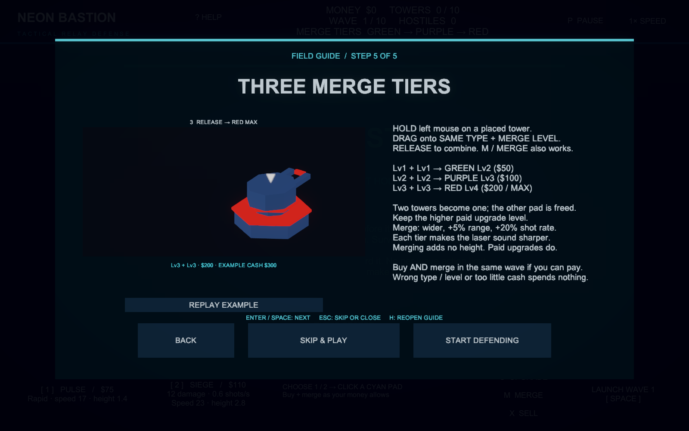
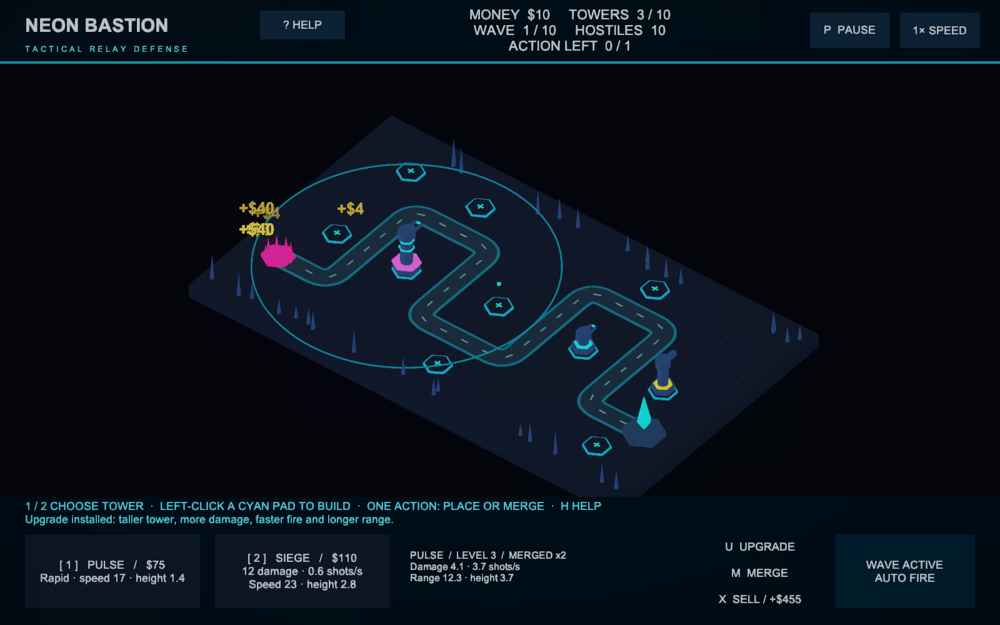

# Neon Bastion — 3D Physics Tower Defense

A complete tower-defense game built from the Tower-Projectiles starter assignment. Protect the cyan relay at the end of a winding route. **One escaped enemy ends the game.** Defeat all ten waves to win.

## Open in Unity

1. In Unity Hub, choose **Add → Add project from disk** and select this folder.
2. Open it with **Unity 6000.6.0f1**, the editor already installed on this Mac.
3. Double-click **Assets/Scenes/NeonBastion.unity** in the Project panel.
4. Press **Play**, then click **ENTER SECTOR** or press Enter. Follow the five-step quick tutorial, or choose **SKIP & PLAY**.

The downloaded starter used Unity 6000.3.23f1. This separate copy was opened with 6000.6.0f1. The original starter is preserved in Downloads. `SampleScene.unity` and its scripts are retained for reference; use `NeonBastion.unity` for the assignment.

The board, camera and interface appear when Play starts. Custom drone hulls, turret platforms, crystals and curved-road meshes are saved in `Assets/Defense/Resources/DefenseMeshes`.

## Controls

| Action | Control |
| --- | --- |
| Choose Pulse / Siege tower | Buttons or **1 / 2** |
| Place a tower | Left-click a free cyan hexagonal pad |
| Inspect tower and show range | Left-click its occupied pad |
| Launch next wave | Button or **Space** |
| Upgrade selected tower | Button or **U** |
| Merge matching placed towers | Hold left mouse on one, drag onto a same-type tower, release |
| Click-based merge | Select a tower → **M / MERGE** → click a matching tower; **Escape** cancels |
| Sell selected tower | Button or **X** |
| Reopen quick tutorial | **? HELP** button or **H** |
| Tutorial navigation | **Next / Back**, Enter / Space, or Left Arrow; Escape skips/closes |
| Pause / resume | Button or **P** |
| Toggle 1× / 2× speed | Speed button |
| Start / replay | Button or **Enter** |

Towers choose targets, predict movement, and fire automatically. You can build and upgrade during a wave. Build only on marked pads, with **ONE action per wave: PLACE a tower OR MERGE a matching pair**. You cannot do both or merge twice in the same wave. Setup and combat share the action; selling does not restore it, and unused actions do not accumulate. There are ten pads. You start with **$110**. Money comes from monster kills, with no wave-clear bonus.

Begin with one Pulse tower on the gold **START HERE** pad (left interior). Wave 1 is a training wave: ten Scouts with 3 HP, speed 2 and a 1.4-second spawn interval. It can be cleared without upgrades on the three tested opening pads, using either tower type. Normal Scout stats and tougher crowds return in wave 2. The first kill gives you enough money for its level-2 upgrade. Save for a Siege tower near the center in wave 2. Each later wave unlocks one action, which can be used for a placement or a merge during setup or combat. Cash upgrades are still allowed after either choice. Cover several road sections with each tower and balance purchases against upgrades.

## Quick tutorial and placement overlay

The guide explains five steps: choose a Pulse or Siege tower, left-click a cyan hex pad, earn cash from defeated enemies, purchase upgrades, and watch matching placed towers merge in a looping 3D demonstration. The example shows a cursor dragging one actual tower model onto another, the result growing, and the example action count changing from 1 to 0 so placement is visibly locked. It lists the tower prices and enemy payouts and gives a concrete example: a $75 Pulse leaves $35; the opening wave earns $40, so saving for another tower matters. It also explains the one-new-tower-per-wave rule and the extra damage, firing speed, range and 0.8-unit height increase from upgrades.

The guide opens from the title screen and can be reopened with **H** or **? HELP**. Opening it during play pauses the battle. Closing it restores the prior pause state and 1x/2x speed without resetting cash, towers or waves. A persistent textual overlay says **1 / 2 CHOOSE TOWER · LEFT-CLICK A CYAN PAD TO BUILD**, so placement instructions remain available after the guide closes.

## Towers

| Stat at level 1 | Pulse | Siege |
| --- | --- | --- |
| Placement cost | 75 | 110 |
| Shots per second | 2.4 | 0.6 |
| Projectile speed | 17 units/s | 23 units/s |
| Turret height | 1.4 units | 2.8 units |
| Damage per hit | 1.15 | 12 |
| Range | 10.5 units | 14 units |

Towers can reach level 3. Each level increases damage, fire rate, range, and actual turret height by **0.8 units**. The column extends and the firing muzzle rises; glowing collars mark upgrades. Upgrades cost $100 and $200 per represented tower unit. A two-unit merged tower costs $200 and $400, so fusion does not make future upgrades cheap. Selling returns 70% of the tower's total investment but never restores a used wave allowance. You cannot sell your last tower when no replacement placement remains.

## Merge matching towers

Buy two towers across different waves, then **hold the left mouse button on one, drag onto the other, and release**. A moving preview and destination ring indicate the action: green means a valid match, pink means the types differ. You can also select a tower, press **M** or click **MERGE**, then click its partner. Escape cancels. Clicking a tower's upper model works as well as clicking its pad.

- **Pulse + Pulse** and **Siege + Siege** merge. Different types, the same actor, paused play and the tutorial overlay cannot merge.
- The source is consumed and the result stays on the destination pad. Invalid drops return the source to its original pad without changing money or towers.
- The higher paid upgrade level is retained, combined tower count appears as **MERGED xN**, and the result has greater damage, fire rate, range, height and footprint, with a violet fusion ring. Already-merged towers can combine again with matching types, including at paid level 3.
- Merging charges no additional cash and preserves both towers' total purchase/upgrade investment for the 70% sell refund. It **consumes the same action as placing a tower**: after merging, you cannot place or merge again until the next wave. After placing, you cannot merge that wave. The freed pad can be used when a future wave grants an action.
- A tower stops firing while its drag preview is active; it resumes from its original position after a cancelled drop. The preview does not move its physical firing location or add a new tower.

## Enemies

| Type | Speed | Base HP | Kill reward | Role |
| --- | --- | --- | --- | --- |
| Scout | 2.6 units/s | 4 | $4 | Standard drone |
| Runner | 3.9 units/s | 3 | $5 | Fast, lightly armored |
| Armored | 1.65 units/s | 12 | $8 | Slow, durable crawler |
| Siege | 1.25 units/s | 48 | $30 | Wave-5 elite |
| Motorcycle | 5.2 units/s | 6 | $6 | Fast two-wheeled vehicle, introduced in wave 4 |
| Truck | 1.05 units/s | 160 | $40 | Huge armored cargo truck, introduced in wave 5 |

Every destroyed monster pays immediately, with a gold `+$` popup and an updated money balance.

Outside the training wave, HP increases by 12% of base per wave after wave 1. Ten waves contain 10, 24, 32, 40, 48, 56, 64, 72, 80 and 96 enemies, for **522 enemies total**, including **291 Scouts**. See [WAVE_GUIDE.md](WAVE_GUIDE.md) for the full breakdown. Truck HP reaches 236.8 on its first appearance and 332.8 in wave 10. Motorcycles have spinning wheels and a rider; trucks have six wheels, an armored cab, cargo body, lights and fitted hitboxes.

## Assignment coverage

See [ASSIGNMENT_NOTES.md](ASSIGNMENT_NOTES.md) for the requirement-to-code map and the predictive aiming explanation. All C, B and A features are implemented. Upgrades, selling, a ten-wave campaign, range indicators, health bars, impact effects, pause, speed control, menus and replay are additional polish; the instructor determines whether these earn A+ credit.

## Checks and preview

Use **Tools → Neon Bastion → Validate assignment and campaign** while outside Play mode to run the actual-scene checks. The validator opens the game scene, exercises its physics and controls through their shared game methods, plays an automated campaign, and exits Play mode. It does not save test placements into the scene. See `VALIDATION.md` for results and limits.

The scene and custom mesh assets can be rebuilt with **Tools → Neon Bastion → Rebuild authored assets and scene**. This intentionally replaces the generated game scene; it is not required for normal play.

## GitHub submission

Upload the entire project folder using GitHub Desktop, including `Assets` with all `.meta` files, `Packages`, and `ProjectSettings`. The `.gitignore` excludes Unity's generated Library, Temp, Logs and local settings. Git LFS is not required. Add this folder as a new local repository, make an initial commit, then publish it to your GitHub account. Submit the repository link; if private, invite the instructor as a collaborator.

## Asset attribution

The new game models, environment meshes and shader are created in code for this project; no outside art packs were downloaded. Unity's built-in shapes supplement the custom meshes. Starter files and package dependencies remain from the provided Tower-Projectiles project. Read the code and adapt the explanations to your course's attribution requirements before presenting it.

## Sharp Game view on Retina displays

If the whole image or text looks pixelated, stop Play mode, let Unity finish recompiling, then choose **Tools → Neon Bastion → Sharpen Game View** and press Play again. This disables the editor's low-resolution preview and resets its zoom. The project uses native render scale, 4x MSAA and high-quality SMAA; canvas elements snap to pixels, and fine world lines are thickened to avoid disappearing between pixels. Player builds use the render settings without relying on the editor helper.
